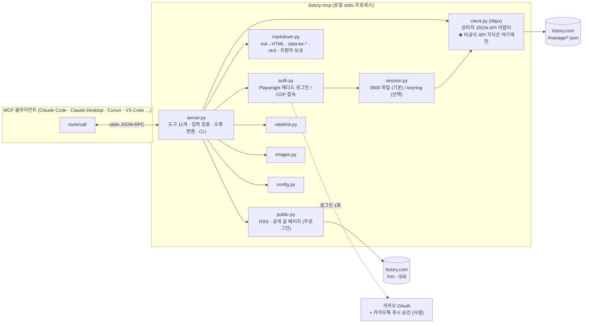

# 아키텍처

`tistory-mcp` 는 티스토리(Tistory) 블로그를 MCP 도구로 다루는 **비공식 로컬 stdio 서버**다.
이 문서는 왜 이런 구조가 됐는지, 각 모듈이 무엇을 책임지는지, 비공식 API 에서 실측된 함정이
무엇인지를 기록한다. Kakao·Tistory 와는 무관한 프로젝트다.

- 패키지: PyPI `tistory-mcp` (`uvx tistory-mcp`), Python ≥ 3.11, MIT
- 저장소: https://github.com/jangsejong/tistory-mcp
- 클라이언트 등록 이름: `tistory`

## 1. 배경과 선택

### 1.1 Open API 종료

티스토리 Open API 는 2024년 2월에 종료됐다. 앱 등록과 토큰 발급 자체가 막혀 있어
"공식 API 를 MCP 로 감싼다"는 접근은 성립하지 않는다. 남는 것은 로그인한 브라우저가 쓰는
경로를 그대로 쓰는 방법뿐이다.

### 1.2 남은 경로 3안

| 경로 | 방식 | 능력 | 평가 |
|------|------|------|------|
| (a) 쿠키 세션 + 관리자 내부 JSON API | 헤디드 브라우저로 로그인 1회 → 쿠키 확보 → `/manage/*.json` 을 HTTP 로 직접 호출 | 글 CRUD·이미지 업로드·카테고리·자동저장 | **채택.** 브라우저 없이 동작해 빠르고 안정적. 단 비공식이라 변경 위험 |
| (b) 에디터 UI 자동화 (Playwright) | 사람이 에디터를 쓰는 동작을 재현 | 쓰기 가능 | 느리고 DOM 개편에 취약. 폴백 후보로만 둠 |
| (c) RSS / 공개 페이지 파싱 | `/rss`, `/{id}` | **읽기 전용** | 무로그인 조회 보조 수단 (`public.py`) |

(a)를 고른 근거: 관리자 화면 대부분이 `.json` 변종으로 데이터를 제공한다는 점이 다른
구현(kim-se-hee/tistory-mcp, §6)에서 이미 관찰돼 있었고, 로그인 1회 뒤에는 httpx 요청만으로
모든 도구가 동작한다. (b)는 (a)가 막혔을 때의 폴백이고, (c)는 쓰기가 없다.

### 1.3 인증 제약 — 완전 무인 운영은 설계상 불가

`/manage` 접근은 카카오 OAuth 를 거치고, **카카오톡 푸시 2차 인증을 사람이 승인**해야 한다.
푸시 승인은 자동화할 수 없고, 우회를 시도하는 것은 보안·약관 양면에서 부적절하다. 따라서

- 최초 로그인(과 세션 만료 뒤 재로그인)은 **헤디드 브라우저 + 사람 개입 1회**다.
- 그 뒤에는 쿠키가 살아 있는 동안 브라우저 없이 동작한다.
- cron 같은 완전 무인 파이프라인은 세션 만료 시 멈춘다. 만료는 숨기지 않고
  "세션 만료 → `tistory_session_init` 재실행"이라는 명확한 오류로 노출한다.

## 2. 구성도



텍스트 버전:

```
MCP 클라이언트 ⇄ stdio(JSON-RPC) ⇄ server.py
                                      ├─ client.py (httpx) ───────────→ tistory.com /manage/*.json
                                      ├─ auth.py (Playwright / CDP) ──→ 카카오 로그인(사람 승인) → session.py (0600 파일 | keyring)
                                      ├─ markdown.py (md → HTML, data-ke-*, nh3, 치환자 보호)
                                      ├─ public.py ───────────────────→ tistory.com /rss, /{id} (무로그인)
                                      ├─ ratelimit.py (60초 / 20건·일, 파일 영속 + 스레드 락)
                                      ├─ images.py (PNG/GIF/JPEG/WebP 헤더 → 픽셀 크기)
                                      └─ config.py (환경변수, 경로, 호스트 allowlist, CDP 검증)
```

### 모듈별 책임

| 모듈 | 책임 |
|------|------|
| `server.py` | `MCPServer` 인스턴스, 도구 11개 정의, 입력 검증(pydantic `Field`), 어댑터 예외 → `ToolError` 변환, CLI(`serve`·`install-browser`·`login`·`status`·`logout`). **엔드포인트 지식 없음.** |
| `client.py` | ★ 관리자 JSON API 어댑터(httpx). URL·요청 본문 스키마·응답 해석·세션 만료 판정·attachment ref·이미지 치환자 생성이 **전부 여기**. |
| `auth.py` | 헤디드 로그인 1회. 번들 Chromium → Chrome → Edge 순으로 시도하거나, `cdp_url` 로 이미 떠 있는 브라우저에 접속. Playwright 는 이 함수 안에서만 지연 import. |
| `session.py` | 쿠키 저장소. 기본 0600 파일, 선택 keyring. 블로그 호스트에 매칭되는 쿠키만 보관, 쿠키 헤더 직렬화, 만료 계산. |
| `markdown.py` | markdown-it-py 렌더 → 에디터 서식 속성(`data-ke-*`) → nh3 sanitize. 이미지 치환자를 nonce placeholder 로 보호·복원. |
| `public.py` | 무로그인 읽기: RSS(`/rss`)·공개 글 페이지(`/{id}`) 파서. 로그인 리다이렉트는 최종 URL 로 판별. |
| `ratelimit.py` | 발행·수정 최소 간격과 일일 상한. 파일 영속 + 스레드 락. |
| `images.py` | PNG/GIF/JPEG/WebP 헤더에서 픽셀 크기 추출(외부 의존 없음). |
| `config.py` | 환경변수 → `Settings`, 저장 경로, 호스트 정규화·allowlist, CDP 주소 검증. |

**원칙: 비공식 API 지식은 `client.py` 한 곳에만.** 내부 엔드포인트는 언제든 바뀔 수 있다.
도구 계층(`server.py`)은 어댑터 메서드만 호출하고 URL·필드명을 모른다. `public.py` 가 아는 것은
공개 HTML·RSS 의 구조이지 관리자 API 가 아니다.

### 도구 목록

| 도구 | annotation | 하는 일 |
|------|-----------|---------|
| `tistory_session_init` | write | 헤디드/CDP 로그인 → 쿠키 저장 |
| `tistory_session_status` | read | 저장 세션 유무·만료 시각·실시간 유효성(API 1회 호출) |
| `tistory_get_categories` | read | 카테고리 트리(정수 id) |
| `tistory_list_posts` | read | 관리자 글 목록(비공개 포함, 본문 없음) |
| `tistory_get_post` | read | 메타(관리자 목록) + 본문 HTML(글 페이지) |
| `tistory_fetch_public_posts` | read | 아무 블로그의 RSS, 무로그인 |
| `tistory_publish_post` | write | 새 글 발행(기본 비공개) |
| `tistory_update_post` | write | 글 수정(full body) |
| `tistory_delete_post` | destructive | 삭제, `confirm=true` 필수 |
| `tistory_upload_image` | write | 이미지 업로드 → `substitution` + `attachment_ref` |
| `tistory_save_draft` | write | 에디터 자동저장 슬롯(1개)에 초안 저장 |

## 3. 설계 결정

### 3.1 공식 `mcp` SDK 2.x

- `from mcp.server.mcpserver import MCPServer` — 2.x 에서 FastMCP 가 `MCPServer` 로 개명됐다.
  서드파티 `fastmcp` 패키지는 쓰지 않는다. stdio 전송, 도구 데코레이터, `ToolAnnotations`,
  `ToolError` 까지 공식 SDK 만으로 충분하다.
- 파라미터는 `Annotated[..., Field(...)]` 로 설명·범위를 입력 스키마에 싣는다. 도구마다
  `readOnlyHint`·`destructiveHint`·`idempotentHint`·`openWorldHint` 를 선언해 클라이언트가
  확인 UI 를 띄우거나 병렬 실행 여부를 판단할 수 있게 한다.
- 어댑터 예외는 `_translate` 한 곳에서 `ToolError` 로 바꾼다. 도구가 직접 던진 `ToolError`
  는 그대로 통과시켜 "ToolError: ToolError: …" 식 이중 래핑을 막는다.

### 3.2 세션 저장소 — 기본 파일(0600), keyring 은 선택

- 기본: `~/.config/tistory-mcp/sessions/<host>.json` (디렉터리 0700, 파일 0600, 임시 파일 +
  `os.replace` 원자 저장, 로드 시 권한이 느슨하면 0600 으로 조임). 위치는
  `TISTORY_MCP_HOME` 또는 `XDG_CONFIG_HOME` 으로 바꾼다.
- 선택: `TISTORY_MCP_SESSION_STORE=keyring` + `pip install "tistory-mcp[keyring]"`.
- 이유: 헤드리스 Linux·WSL 에는 Secret Service(D-Bus 데몬)가 없는 경우가 흔해 keyring 을
  기본으로 두면 첫 실행부터 실패한다. 또 흔한 데스크톱 구성에서는 로그인 키링이 빈 비밀번호
  + 0600 파일로 운영되기도 해 보안 수준이 0600 JSON 과 사실상 같다. Windows 는 keyring
  백엔드 지원 대상이 아니다(파일 저장소 사용).
- 저장하는 쿠키는 블로그 호스트에 매칭되는 것만이다(카카오 도메인 쿠키는 버린다 — 최소 보관).
  쿠키 값은 로그·도구 응답·예외 메시지 어디에도 싣지 않는다.

### 3.3 초안 = 자동저장 슬롯 1개

- 에디터의 자동저장(`GET/POST /manage/autosave`)은 **단일 슬롯**이다. 관리 화면의
  "임시저장 N개"는 별개의 슬롯인데 그 엔드포인트는 실측되지 않았다.
- `tistory_save_draft` 는 자동저장 슬롯만 쓴다(다음 저장이 덮어쓴다). 검토 가능한 초안을
  여러 개 두려면 `visibility='private'` 로 발행하고 `tistory_update_post` 로 공개 전환하는
  것이 정답이다.
- 요청 본문의 `published` 는 초안 토글이 아니다(§5).

### 3.4 안전 게이트

| 게이트 | 내용 | 이유 |
|--------|------|------|
| 비공개 기본 | `tistory_publish_post` 기본 `visibility='private'`, `public` 이면 응답에 경고 | AI 가 쓴 글을 사람이 검토한 뒤 공개 |
| 삭제 확인 | `confirm=true` 필수 + `destructiveHint=True` | 되돌릴 수 없음. 클라이언트도 확인 UI 를 띄울 수 있게 |
| rate limit | 발행·수정 합산 최소 60초 간격, 일 20건 (`TISTORY_MCP_MIN_INTERVAL_SEC`, `TISTORY_MCP_DAILY_CAP`), 파일 영속 | 대량 발행은 저품질 블로그 판정·계정 제재 위험 — 사용자 보호 장치 |
| 호스트 allowlist | `*.tistory.com` 만 허용, `TISTORY_MCP_ALLOW_ANY_HOST=1` 로 해제 | SSRF·오발행 방지 |
| CDP loopback | `cdp_url` 은 `localhost`/`127.0.0.1`/`::1` 만, `TISTORY_MCP_ALLOW_REMOTE_CDP=1` 로 해제 | 원격 브라우저에 로그인 쿠키가 남지 않게 |
| 빈 본문 거부 | `tistory_update_post` 는 `content` 필수 | PUT 이 full body 라 빈 본문이면 글이 지워짐 |
| 태그 보존 | 수정 시 `tags` 미지정이면 글 페이지의 `a[rel=tag]` 에서 읽어 보존, 못 읽으면 거부 | full body PUT 에서 태그 유실 방지 |
| 이미지 입력 검증 | 확장자 png/jpg/jpeg/gif/webp, 20MB 상한 | 임의 파일 업로드 방지 |
| rate limit 소비 시점 | 세션·호스트 검사를 통과한 뒤, 요청 직전에 기록 | 세션 없음 같은 실패 호출이 60초 슬롯을 소비하지 않게 |

### 3.5 sanitize 순서와 이미지 치환자

```
마크다운 경로: 치환자 보호 → markdown-it 렌더 → 에디터 서식 속성(data-ke-*) → nh3 sanitize → 치환자 복원
HTML 경로:     치환자 보호 → nh3 sanitize → 치환자 복원
```

- **에디터 서식 속성은 sanitize 전에 붙인다.** 에디터로 쓴 글은 `p[data-ke-size]`,
  `h2/h3/h4[data-ke-size]`, `blockquote[data-ke-style]`, `hr[data-ke-style]`,
  `ul/ol[data-ke-list-type]`, `table[data-ke-align]` 같은 속성을 갖고, 블로그에 실리는
  `content.css` 가 이 셀렉터에 규칙을 건다. 속성이 없으면 마크다운 변환본은 에디터 글과
  다르게 보인다. 속성을 sanitize **뒤**에 붙이면 nh3 가 마지막 관문이 아니게 되고 화이트리스트
  밖 값이 섞일 수 있어, **앞에서 화이트리스트 안의 값만 붙이고 nh3 가 마지막에 선다.**
  변환 결과를 `html` 형식으로 다시 보내도 변화가 없다(no-op). 속성 부여는 마크다운 경로에서만
  하고, html 경로는 쓴 그대로 sanitize 한다. 글머리표는 ul·ol 을 함께 센 깊이로
  disc → circle → square 를 준다.
- **이미지 치환자** `[##_Image|kage@…|CDM|1.3|{json}_##]` 는 nh3 를 그대로 통과하면 깨지므로
  보호가 필요하다. 보호는 **`tistory_upload_image` 가 돌려주는 형태와 정확히 일치할 때만**
  한다: 호출마다 새로 만드는 nonce 가 든 placeholder(`TISTORYIMG<nonce>N<i>X`)로 바꿨다가
  sanitize 뒤 글자 그대로 복원한다. 느슨한 매칭을 허용하면 치환자처럼 생긴 구간 안의 HTML 이
  sanitize 를 우회하므로, 형태가 어긋난 후보가 하나라도 있으면 본문 전체를 거부한다
  (`InvalidImageSubstitutionError`). nonce 덕에 본문이 placeholder 를 위조해 넣어도 복원되지
  않는다.

### 3.6 발행 실패 시 중복 경고

`POST /manage/post.json` 은 요청이 나간 뒤 타임아웃·이상 응답이 와도 글이 이미 만들어졌을 수
있다. 어댑터는 발행 실패 오류에 "글이 이미 생성됐을 수 있습니다. 재시도 전에
`tistory_list_posts` 로 확인하세요"를 덧붙이고, 서버 instructions 도 자동 재시도를 금지한다.

### 3.7 rate limit 스레드 락

동기 도구 함수는 SDK 가 워커 스레드에서 실행한다. 클라이언트가 발행을 두 번 병렬 호출하면
둘 다 간격 검사를 통과할 수 있고, POST 는 항상 신규라 글이 둘 생긴다. 그래서 모듈 전역
`threading.Lock` 으로 검사와 기록을 직렬화한다. 프로세스 간(클라이언트 둘을 동시에 띄운
경우)은 직렬화하지 않는다.

### 3.8 그 밖에

- 환경변수는 호출 시점에 읽는다(테스트 격리). 서버는 클라이언트 설정의 `env` 로 값을 받는다.
- 로그는 stderr 로만 낸다. stdout 은 JSON-RPC 채널이다.
- Playwright 는 로그인 함수 안에서만 import 한다. 서버 기동과 조회·발행 도구는 브라우저 없이
  동작한다.
- 이미지 크기는 파일 선두 64KB 헤더에서 읽는다. JPEG 의 EXIF/ICC 가 64KB 를 넘으면 0 이 남을
  수 있어 그때는 `width`/`height` 인자로 지정한다.

## 4. 엔드포인트 기준선 (관리자 내부 API)

출처: 아래 표의 엔드포인트·필드·만료 신호·치환자 형식은 **kim-se-hee/tistory-mcp 의
`docs/api.md`(MIT) 에 기록된 관찰**을 기준선으로 삼았다(`THIRD_PARTY_NOTICES.md`). 코드는
가져오지 않았다. 모두 비공식이며 예고 없이 바뀔 수 있다. 티스토리가 바뀌면 이 표와
`client.py` 를 함께 고친다.

| 동작 | 메서드 · 경로 | 용도 | 주의 |
|------|---------------|------|------|
| 글 목록 | `GET /manage/posts.json?category=-3&page=1&searchKeyword=&searchType=title&visibility=all` | 관리자 목록(비공개 포함), 본문 없음 | 필터 값은 서버 어휘로: `visibility` = `all`/`visible`/`hidden`/`protect`, `searchType` = `title`/`content`/`tag` — 다른 값은 400(실측). 도구의 `public`/`private`/`protected` 는 `client.py` 가 매핑. 응답 `visibility` 는 `PUBLIC`/`PRIVATE`/`PROTECTED` 문자열 |
| 카테고리 | `GET /manage/category.json` | `categories` 트리 + `rootLabel` | 발행·수정에는 이름이 아니라 정수 id |
| 발행 | `POST /manage/post.json` → `{entryUrl}` | 새 글 | **항상 신규.** 본문의 id 는 무시됨 |
| 수정 | `PUT /manage/post/{id}.json` → `{entryUrl}` | 글 수정 | **full body.** 빠진 필드는 기본값으로 덮인다 |
| 삭제 | `DELETE /manage/post/{id}.json` → `{data:{id}}` | 글 삭제 | 되돌릴 수 없음 |
| 이미지 | `POST /manage/post/attach.json` (multipart 필드 `file`) → `{url,key,filename,size}` | 업로드 | 본문에는 URL 이 아니라 치환자, `attachments[]` 에 ref |
| 자동저장 | `GET /manage/autosave` → `{autosavedEntry: {title,content,tags,categoryId,draftSequence,totalWritingTimeMs,thumbnail,createdAt} \| null}` / `POST /manage/autosave` `{title,content,tags,categoryId,draftSequence,totalWritingTimeMs}` | 단일 슬롯 | 수동 임시저장과 별개 |
| 공개 페이지 | `GET https://{host}/{id}` (세션 쿠키를 붙이면 비공개 글도) | 본문 HTML·태그·메타 | 본문 컨테이너 셀렉터 4단계 폴백 |
| RSS | `GET https://{host}/rss` | 최근 글(최대 50건), `description` = 본문 HTML | 무로그인 |

글 본문(`post.json` / `post/{id}.json`) 필드:

```
id("0" | 글 번호), title, content(HTML), slogan(URL slug), visibility(0 private / 15 protected / 20 public),
category(정수 id, 0 = 없음), tag("a,b,c" 콤마 구분), published(1), password, type("post" | "page"),
attachments([attachment_ref, ...]), draftSequence(null), totalWritingTimeMs(0),
uselessMarginForEntry(1), cclCommercial(0), cclDerive(0), recaptchaValue("")
```

이미지 참조 형식(`client.py` 가 생성):

```
attachment_ref = kage@{key}/{filename}?{query}      (query 의 & 는 &amp; 로)
substitution   = [##_Image|{attachment_ref}|CDM|1.3|{"originWidth":W,"originHeight":H,"style":"alignCenter"}_##]
```

`style` 은 `alignCenter` · `alignLeft` · `alignRight` · `widthOrigin` 중 하나.

### 세션 만료 신호 3종

어댑터는 `follow_redirects=False` 로 요청하고, 아래 셋을 모두 `SessionExpiredError` 로 바꾼다.

| 신호 | 판별 |
|------|------|
| `401` | 상태 코드 |
| `302` → 로그인 | `Location` 에 `/auth/login` 또는 `accounts.kakao.com` |
| `200` + 로그인 HTML | 본문이 JSON 으로 시작하지 않고 로그인 마커(`accounts.kakao.com`, `/auth/login`, `id="loginKey"` 등)를 포함 |

세 번째 신호는 JSON 엔드포인트 응답에만 적용한다. 공개 글 페이지에는 이 마커가 항상 들어
있어서(§5) `public.py` 는 마커가 아니라 **최종 URL** 로 판별한다.

## 5. 실측 함정

잊으면 도구가 무너지는 것들. 모두 실제 블로그에서 관찰됐다.

1. **`POST /manage/post.json` 은 항상 신규.** 같은 본문을 다시 보내면 글이 둘이 된다.
   재시도 로직은 글을 양산한다. 수정은 반드시 `PUT /manage/post/{id}.json`.
2. **티스토리는 마크다운을 렌더하지 않는다.** 본문은 반드시 HTML 로 보낸다. 도구는
   `content_format='markdown'` 이면 변환해 주지만, `tistory_update_post` 의 기본값은
   `'html'` 이라 마크다운을 그대로 넣으면 원문이 텍스트로 박힌다.
3. **이미지는 치환자의 `kage@…` 값과 `attachments[]` 원소가 글자 단위로 같아야 영구화된다.**
   하나라도 다르거나 `attachments` 를 빠뜨리면 당장은 보여도 약 15일 뒤 404 가 된다.
   `&amp;` 를 `&` 로 "고치는" 것도 불일치다.
4. **`published` 는 초안 토글이 아니다.** 진짜 임시저장(수동 N개)은 엔드포인트가 실측되지
   않았고, 자동저장 슬롯(1개)만 `/manage/autosave` 로 다룬다.
5. **공개 페이지의 설정 JS 에는 `LOGIN_URL`(`/auth/login`)이 항상 들어 있다.** 본문 마커로
   "로그인 페이지인가"를 판별하면 모든 공개 글이 오탐된다. `public.py` 는 리다이렉트가 끝난
   **최종 URL** 의 호스트·경로로 판별한다. 마커 판별은 JSON 엔드포인트 응답에만 쓴다.
6. **태그 표기가 바뀔 수 있다.** `"AI 코딩"` 을 보냈는데 공개 페이지에는 `ai 코딩` 으로
   보인 관찰이 1건 있다. 같은 이름의 기존 태그 표기로 합쳐지는 것으로 보이나, 전부
   소문자화와 구별하는 실험은 하지 않았다. `tags` 를 지정한 수정 응답은 보낸 값(공백 정리
   후)이라 공개 페이지와 다를 수 있다.
7. **큰 본문은 도구 인자에 직접 쓰지 않는다.** 수십 KB HTML 을 AI 가 인자에 옮겨 쓰면
   전사 오류가 난다. 인자를 JSON 파일로 만들고 `scripts/mcp_call.py … @args.json` 으로
   넘긴다(명령행 인자 하나는 128KiB 상한이라 `"$(cat …)"` 도 안 된다). 세션 파일을
   공유하므로 별도 프로세스에서도 동작한다.
8. **stdio 서버에서 stdout 에 print 금지.** stdout 은 JSON-RPC 채널이다. 로그는 stderr.
   자식 프로세스의 출력도 stdout 을 오염시킬 수 있다 — 예컨대 D-Bus 가 띄우는 키링·접근성
   데몬의 안내 문구가 stdout 으로 흘러들어 클라이언트가 파싱 오류를 내는 사례가 있었다.
   서버 안에서 무언가를 실행한다면 stdout 을 분리한다.
9. **에디터 UI 자동화 폴백 시 CodeMirror 함정(참고용).** `/manage/newpost/` 의 마크다운
   에디터에 `cm.setValue(text)` 만 하면 에디터의 React 상태가 갱신되지 않아 자동저장·임시저장
   본문이 빈 문자열로 나간다. `cm.replaceRange(text, {line: 0, ch: 0}, undefined, '+input')`
   처럼 사용자 입력 origin 으로 넣어야 한다. 이 프로젝트는 에디터를 거치지 않으므로 해당
   없지만, 폴백을 만들 때 잊기 쉬워 적어 둔다.
10. **`tistory_get_post`/`tistory_update_post` 의 메타는 관리자 목록 최근 20페이지 안에서만
    찾는다.** 그 밖의 오래된 글은 조회는 본문만 돌려주고(메타 생략), 수정은 거부한다.

## 6. 다른 구현과의 차이

같은 문제를 푸는 TypeScript 구현 **kim-se-hee/tistory-mcp**(MIT, npm `tistory-mcp`)가 있다.
두 프로젝트는 같은 관리자 JSON 엔드포인트와 "헤디드 로그인 1회 → 쿠키" 흐름을 쓰므로
티스토리 쪽 변경은 양쪽에 같이 영향을 준다. 차이는 사실만 적는다.

| 항목 | kim-se-hee/tistory-mcp | tistory-mcp (이 프로젝트) |
|------|------------------------|---------------------------|
| 언어 · 배포 | TypeScript, npm (`npx`) | Python ≥ 3.11, PyPI (`uvx tistory-mcp`) |
| 세션 저장 | OS 키체인 | 0600 파일 기본, keyring 선택 |
| 도구 범위 | 글·이미지에 더해 스킨 편집·미리보기 도구 | 글·이미지·카테고리 조회·자동저장·RSS. **스킨 도구 없음** |
| 추가 게이트 | — (해당 프로젝트 문서 참조) | 발행 기본 비공개, 삭제 `confirm`, rate limit, 호스트 allowlist, CDP loopback, 치환자 엄격 검증 |

이 프로젝트의 엔드포인트 기준선(§4)은 그 프로젝트의 `docs/api.md` 관찰에서 파생됐다
(`THIRD_PARTY_NOTICES.md`).

## 7. 확장 포인트

- **티스토리가 바뀌면 `client.py` 만 수리한다.** URL·요청 본문·응답 해석·만료 판정이 전부
  거기 있다. `tests/test_client.py` 의 `httpx.MockTransport` 핸들러를 새 응답 형태로 바꿔
  회귀를 고정하고, §4 표를 갱신한다.
- **새 도구 추가 위치**: `server.py` 에 `@server.tool(title=…, annotations=_READ | _WRITE |
  _DESTRUCTIVE)` 로 정의한다. 세션이 필요하면 `_client(blog_url)` 로 어댑터를 얻고, 예외는
  `raise _translate(exc) from exc` 로 변환한다. 어댑터 메서드는 `client.py` 에 둔다.
  쓰기 도구라면 `_rate_limiter().check_and_record(...)` 를 요청 직전에 넣는다.
- **테스트는 네트워크 0.** 어댑터는 `httpx.MockTransport` 핸들러로, 도구 계층은 `_client` 를
  monkeypatch 한 가짜 클라이언트로 검증한다. `tests/conftest.py` 가 `TISTORY_MCP_HOME` 을
  임시 디렉터리로 격리해 실제 세션·rate limit 파일을 건드리지 않는다. 실계정을 호출하는
  테스트는 두지 않는다.
- **스모크**: `python scripts/mcp_probe.py uvx tistory-mcp` 로 initialize + tools/list 를
  확인한다(`PROBE OK`, 도구 11개).
- **수동 임시저장(N개)** 이 필요해지면 엔드포인트를 실측한 뒤에만 도구로 올린다. UI 폴백을
  만든다면 §5 의 CodeMirror 주의를 지킨다. 검증되지 않은 DOM 셀렉터 코드는 넣지 않는다.
